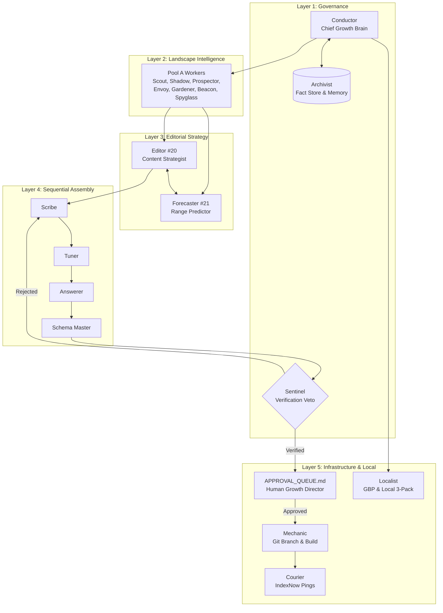

# Agent Topology & Swarm Organization
## Canonical 22-Agent Roster, Functional Layers & Concurrency Model

```
========================================================================================
VIYOGI AGENTIC SEO SWARM — AGENT TOPOLOGY & EXECUTION MODEL
========================================================================================
```

## 1. Five Functional Agent Layers

The swarm organizes **22 specialized agents** into 5 distinct operational layers. Each layer has specific reasoning duties, inputs, outputs, and write permissions:

```
┌─────────────────────────────────────────────────────────────────────────────────────────────┐
│ LAYER 1: GOVERNANCE & STRATEGIC BRAIN (3 Agents)                                            │
│ [1] Conductor (Strategic Brain)  [2] Archivist (Fact Store & Memory)  [3] Sentinel (Verifier)│
├─────────────────────────────────────────────────────────────────────────────────────────────┤
│ LAYER 2: OPPORTUNITY & LANDSCAPE INTELLIGENCE (8 Agents)                                     │
│ [4] Scout (SERP Tracking)        [5] Prospector (Keywords)           [6] Shadow (Competitors)│
│ [7] Envoy (Authority/Links)       [8] Gardener (Decay/Internal Links) [9] Beacon (AI Citations)│
│ [10] Reporter (KPI Synthesizer)   [11] Spyglass (First-Party Listener)                      │
├─────────────────────────────────────────────────────────────────────────────────────────────┤
│ LAYER 3: EDITORIAL STRATEGY & OUTCOME FORECASTING (2 Agents)                                │
│ [20] Editor (Content Strategist)                                                            │
│ [21] Forecaster (Predictive Range P10/P50/P90 & Retrospective Calibration)                  │
├─────────────────────────────────────────────────────────────────────────────────────────────┤
│ LAYER 4: SEQUENTIAL CONTENT ASSEMBLY LINE (4 Agents - Drafts Only)                          │
│ [12] Scribe (Authoritative Drafter) ➔ [13] Tuner (On-Page SEO) ➔                             │
│ [14] Answerer (AEO Direct Answers)   ➔ [15] Schema Master (JSON-LD Linked Data)              │
├─────────────────────────────────────────────────────────────────────────────────────────────┤
│ LAYER 5: INFRASTRUCTURE, DIGITAL PR, BROADCAST & LOCAL (5 Agents)                           │
│ [16] Mechanic (Production Code & SSG)   [17] Scholar (Policy & Guidelines)                  │
│ [18] Networker (Digital PR Pitch)       [19] Herald (Industry News & Seasonal Velocity)     │
│ [+] Localist (GBP & Maps 3-Pack)        [+] Courier (Fast IndexNow & Google Indexing Pings) │
└─────────────────────────────────────────────────────────────────────────────────────────────┘
```

---

## 2. Master Agent Roster Summary

| # | Agent Name | Tier | Primary Mission | Tools & Connectors | Write Scope |
| :-: | :--- | :--- | :--- | :--- | :--- |
| **1** | **Conductor** | Pro | Strategic orchestrator; determines Next Best Action based on empirical telemetry. | Antigravity Orchestrator, Task Queue, Memory Query | `STRATEGY_STATE`, `TASK` |
| **2** | **Archivist** | Flash | Single source of truth; manages Knowledge Bank facts and 4-level Strategic Memory. | Database (D1/Firebase/SQLite), Knowledge Bank | `KNOWLEDGE_FACT`, `LEARNING` |
| **3** | **Sentinel** | Pro | Zero-tolerance verification gatekeeper; exercises absolute veto on false claims. | Diff Validator, Rich Results Schema Tester | `CONTENT_APPROVAL` (Veto) |
| **4** | **Scout** | Flash-Lite | Monitors daily/weekly rankings and identifies striking-distance queries (pos 4–20). | DataForSEO Live Advanced SERP, GSC MCP | `SERP_SNAPSHOT`, `KEYWORD` |
| **5** | **Prospector** | Flash | Discovers search queries and clusters buyer intents across user journeys. | DataForSEO Suggestions, Google Ads Planner | `KEYWORD`, `INTENT_MAP` |
| **6** | **Shadow** | Flash | Deconstructs competitors' architectures, content structures, and market gaps. | Firecrawl Scraper, DataForSEO Domain Intersection | `COMPETITOR`, `CONTENT_GAP` |
| **7** | **Envoy** | Flash | Analyzes backlink profiles and authority gaps across industry media and citations. | DataForSEO Backlinks API, Bing Webmaster | `AUTHORITY_GAP` |
| **8** | **Gardener** | Flash | Detects content decay (>20% drop) and optimizes contextual internal link paths. | GSC API, Internal Link Graph Engine | `DECAY_ALERT`, `LINK_PLAN` |
| **9** | **Beacon** | Flash | Evaluates visibility and citations in AI Overviews, Perplexity, ChatGPT, Copilot. | AI Visibility Engine, Web Search | `AI_VISIBILITY` |
| **10** | **Reporter** | Flash-Lite | Synthesizes rankings, traffic, and inquiries into executive trackers and dashboards. | Data API (GA4, GSC), Python Excel/Markdown Gen | `REPORT`, `KPI_SNAPSHOT` |
| **11** | **Spyglass** | Flash-Lite | Real-time stream listener polling GSC, GA4, and Bing for crawl anomalies and spikes. | `gsc-mcp`, `analytics-mcp`, `bing-webmaster` | `STREAM_ALERT` |
| **20** | **Editor** | Pro | Content strategist; determines Create New vs Update vs Consolidate vs Do Nothing. | Content Intelligence Engine, PAA Engine | `CONTENT_BRIEF`, `OPPORTUNITY` |
| **21** | **Forecaster** | Pro | Models outcome ranges (P10/P50/P90), prerequisites, and calibrates forecast error. | Forecast Calibration Engine, Conversion Registry | `FORECAST`, `CALIBRATION` |
| **12** | **Scribe** | Pro | Drafts deep, authoritative copy strictly adhering to project Human Writing Guide. | Markdown Drafter, Archivist Fact Store | `CONTENT_VERSION` (Draft) |
| **13** | **Tuner** | Flash | Fine-tunes titles (<55 chars), meta (<155 chars), H1-H3s, and keyword placement. | On-Page Rules Engine, Length Validator | `CONTENT_CHANGE` |
| **14** | **Answerer** | Flash | Extracts 40–60 word direct-answer snippets and structured FAQ blocks for AEO. | AEO Formatting Engine, PAA Query Bank | `AEO_SNIPPET`, `FAQ_BLOCK` |
| **15** | **Schema Master**| Flash-Lite | Generates valid JSON-LD schemas synchronized with on-page copy. | JSON-LD Architect, Schema.org Validator | `STRUCTURED_DATA` |
| **16** | **Mechanic** | Pro | Production codebase engineer; implements verified changes in isolated git branches. | Git, Next.js SSG, Cloudflare Wrangler | Repository Files (Branch) |
| **17** | **Scholar** | Flash | Validates content against Google Search Essentials, helpful content, and spam policy. | Policy Knowledge Base, Guideline Checker | `COMPLIANCE_VERDICT` |
| **18** | **Networker** | Flash | Drafts bespoke digital PR outreach pitches for editors and authoritative directories. | Email Drafter (Drafts only; zero auto-send) | `PR_PITCH_DRAFT` |
| **19** | **Herald** | Flash | Translates trade shows, events, and seasonal rhythms into topical authority updates. | Event Intelligence Engine, Content Calendar | `EVENT_UPDATE` |
| **[+]** | **Localist** | Flash | Manages Google Business Profile, Google Maps 3-Pack rankings, and local citations. | Google Business Profile API, Local SERP Parser | `LOCAL_AUDIT`, `GBP_UPDATE` |
| **[+]** | **Courier** | Flash-Lite | Fast broadcast worker; pings IndexNow and Google Indexing API upon live release. | IndexNow Client, Google Indexing API | `INDEXING_PING` |

*Legacy Note:* **Advisor** (from V1) functioned as a task-list bookkeeper. In V2/V3, its responsibilities were integrated into Conductor's dynamic task management.

---

## 3. Concurrency & Execution Pools

Running 22 agents concurrently causes severe API rate limits, context thrashing, and workspace collisions. The swarm enforces a **3-Pool Concurrency Model**:

```
┌────────────────────────────────────────────────────────────────────────┐
│ POOL A: PARALLEL READ & ANALYSIS (Safe for High Concurrency)           │
│ Concurrency Ceiling: Semaphore(5)                                      │
│ Workers: Scout, Prospector, Shadow, Envoy, Gardener, Beacon,           │
│          Reporter, Spyglass                                            │
│ Profile: Read-only API calls, parsing structured JSON, zero git locks. │
└────────────────────────────────────────────────────────────────────────┘

┌────────────────────────────────────────────────────────────────────────┐
│ POOL B: SEQUENTIAL CONTENT ASSEMBLY LINE (Pipelined Execution)         │
│ Concurrency Ceiling: 1 (Sequential Chain)                              │
│ Flow: Scribe ➔ Tuner ➔ Answerer ➔ Schema Master ➔ Sentinel             │
│ Profile: Each agent builds directly upon the previous agent's output.  │
│          Sentinel exercises veto before handing off to human approval. │
└────────────────────────────────────────────────────────────────────────┘

┌────────────────────────────────────────────────────────────────────────┐
│ POOL C: ISOLATED WORKSPACE WRITES (Single-Worker Isolation)            │
│ Concurrency Ceiling: 1 (Strict Mutex)                                  │
│ Worker: Mechanic (`Workspace: 'branch'`)                               │
│ Profile: Writes to codebase, verifies builds, creates git pull-request.│
│          Never runs concurrently with any other agent.                 │
└────────────────────────────────────────────────────────────────────────┘
```

### Python SDK Implementation Pattern
```python
import asyncio
from google.antigravity import Agent, LocalAgentConfig

# Pool A: Read/Analysis agents capped at concurrency 5
pool_a_sem = asyncio.Semaphore(5)

async def run_pool_a_worker(agent_name: str, prompt: str):
    async with pool_a_sem:
        async with Agent(LocalAgentConfig(
            name=agent_name,
            model="flash",
            workspace="read-only"
        )) as agent:
            return await agent.chat(prompt)

# Pool B: Sequential content drafting pipeline
async def run_pool_b_pipeline(content_brief: dict):
    async with Agent(LocalAgentConfig(name="scribe", model="pro")) as scribe:
        raw_draft = await scribe.chat(content_brief["prompt"])
    async with Agent(LocalAgentConfig(name="tuner", model="flash")) as tuner:
        tuned_draft = await tuner.chat(raw_draft)
    async with Agent(LocalAgentConfig(name="answerer", model="flash")) as answerer:
        aeo_draft = await answerer.chat(tuned_draft)
    async with Agent(LocalAgentConfig(name="schema-master", model="flash-lite")) as sm:
        draft_with_schema = await sm.chat(aeo_draft)
    async with Agent(LocalAgentConfig(name="sentinel", model="pro")) as sentinel:
        verdict = await sentinel.chat(draft_with_schema)
    return verdict

# Pool C: Mechanic isolated git branch worker
async def run_mechanic(task: dict):
    async with Agent(LocalAgentConfig(
        name="mechanic",
        model="pro",
        workspace="branch"
    )) as mechanic:
        return await mechanic.chat(task["prompt"])
```

---

## 4. Interaction Hierarchy & Governance Boundaries


