# Architecture Overview
## Autonomous, Evidence-Driven AI SEO Framework

```
========================================================================================
VIYOGI AGENTIC SEO SWARM — MASTER SYSTEM ARCHITECTURE
========================================================================================
```

## 1. System Mission & North Star Philosophy

**Viyogi Agentic SEO Swarm** is an autonomous, evidence-driven multi-agent framework designed to operate as a self-calibrating Growth, SEO, AEO (Answer Engine Optimization), GEO (Generative Engine Optimization), and Local Search Department.

The fundamental directive of the system is to continuously resolve:
> **"WHAT IS THE HIGHEST-VALUE NEXT ACTION FOR THIS BUSINESS TO MAXIMIZE QUALIFIED COMMERCIAL INQUIRIES AND REVENUE CONTRIBUTION?"**  
> *(Rather than asking: "What mechanical SEO tasks can we execute today?")*

### 1.1 The 10 North Star Optimization Vectors
1. **Qualified Commercial Inquiries (RFQs / Direct Bookings):** Primary commercial metric.
2. **Verified High-Intent Leads:** Inquiries from confirmed target buyers, procurement managers, plant heads, or qualified guests.
3. **High Commercial-Intent Organic Traffic:** Visitors seeking suppliers, pricing, specifications, or bookings.
4. **Top 1–3 & Striking-Distance Visibility:** Page-one visibility on high-intent transactional queries.
5. **AI Answer Visibility & Direct Citations:** Sourced recommendations in Google AI Overviews, Perplexity AI, ChatGPT Search, and Microsoft Copilot.
6. **Geographic / Export Market Dominance:** Dominance across prioritized domestic and international markets.
7. **Topical & Entity Authority:** Comprehensive, unassailable knowledge graph coverage across all core offerings.
8. **Buyer Journey Coverage:** Intent alignment across investigation, comparison, specification, and procurement.
9. **Organic-to-Inquiry Conversion Rate (CRO):** On-page UX, direct-answer snippets, and CTA optimization.
10. **Attributed Commercial Revenue:** Linking landing page sessions directly to closed business transactions.

> [!IMPORTANT]
> **Traffic volume alone is NOT a North Star metric.** 1,000 irrelevant visits with 0 inquiries is inferior to 150 targeted visits yielding 6 qualified purchase orders or bookings.

---

## 2. The 3-Layer Decoupled Framework Architecture

A central design mandate of Viyogi Agentic SEO Swarm is the strict decoupling of generic agent intelligence from proprietary business context:

```
┌────────────────────────────────────────────────────────────────────────┐
│ LAYER A: REUSABLE CORE FRAMEWORK                                       │
│ • 22 Autonomous Agent Personas (Conductor, Sentinel, Scribe, etc.)    │
│ • 15 Stateless Intelligence Engines (PAA, Headline, Forecast, etc.)   │
│ • 24 Canonical Data Contract Schemas (V3.1 Draft 2020-12)             │
│ • Execution Worker Pools (Pool A Parallel, Pool B Chained, Pool C)     │
│ • Orchestration, Model Routing, and Verification Protocols             │
└───────────────────────────────────┬────────────────────────────────────┘
                                    │ Configures & Binds
                                    ▼
┌────────────────────────────────────────────────────────────────────────┐
│ LAYER B: PROJECT CONFIGURATION                                         │
│ • Project ID, Brand Name, Primary Domain, Target Locales, Currency     │
│ • Enabled Tool Connections (DataForSEO, GSC, GA4, Bing, Firecrawl)     │
│ • Model Routing Tier Assignments & Token Budgets                      │
│ • Governance Policies (Level A / B / C Approval Thresholds)           │
│ • Storage Adapter Binding (D1, SQLite, Firebase RTDB, Filesystem JSON) │
└───────────────────────────────────┬────────────────────────────────────┘
                                    │ Grounds & Constrains
                                    ▼
┌────────────────────────────────────────────────────────────────────────┐
│ LAYER C: PROJECT KNOWLEDGE BANK (Fact Store & Strategic Memory)        │
│ • Single Source of Truth (Technical Specs, Tolerances, Amenities)      │
│ • Human Writing Guide & Brand Voice (Banned Buzzwords, Style Rules)    │
│ • Competitor Registry & Target Domain Intersection Lists               │
│ • 4-Level Strategic Memory (Facts, Observations, Learnings, Rules)     │
│ • Grounded Entity Relationship Schemas                                 │
└────────────────────────────────────────────────────────────────────────┘
```

---

## 3. The 18-Step Closed-Loop Decision Engine

The swarm operates in a continuous, self-calibrating 18-step feedback cycle. It never initiates an action without baseline measurements, and never completes an experiment without logging findings to Strategic Memory:

```mermaid
flowchart TD
    OBS["1. OBSERVE<br/>Collect telemetry: GSC, GA4, DataForSEO, Firecrawl"] --> UND["2. UNDERSTAND<br/>Synthesize metrics, verify entity signals, contextualize data"]
    UND --> DISC["3. DISCOVER<br/>Detect emerging queries, PAA patterns, SERP shifts, competitor gaps"]
    DISC --> COMP["4. COMPARE<br/>Benchmark against tracked competitors and market leaders"]
    COMP --> DIAG["5. DIAGNOSE<br/>Identify root bottlenecks: Intent, Depth, Authority, Snippet, Cannibalization"]
    DIAG --> OPP["6. IDENTIFY OPPORTUNITIES<br/>Score opportunities via Opportunity Engine"]
    OPP --> PRIO["7. PRIORITIZE<br/>Rank by Commercial Score, Intent, Feasibility, Business Impact"]
    PRIO --> FORE["8. FORECAST<br/>Forecaster models range P10/P50/P90, time-to-impact, assumptions"]
    FORE --> DEC["9. DECIDE<br/>Create New, Update Existing, Consolidate, or Do Nothing"]
    DEC --> DES["10. DESIGN EXPERIMENT / ACTION<br/>Draft hypothesis, control baseline, success criteria"]
    DES --> PREP["11. PREPARE<br/>Assembly line drafting: Scribe ➔ Tuner ➔ Answerer ➔ Schema Master"]
    PREP --> GATE{"12. HUMAN APPROVAL<br/>Level B or C Action?"}
    GATE -- Yes --> APPR["Human Review<br/>APPROVAL_QUEUE.md"]
    GATE -- No / Approved --> EXEC["13. EXECUTE<br/>Mechanic worktree, CMS update, IndexNow ping"]
    APPR -- Approved --> EXEC
    APPR -- Rejected --> MEM_REJ["Record Rejection Rationale in Strategic Memory"]
    EXEC --> VER["14. VERIFY<br/>Sentinel checks schema, live HTTP 200, links, factual fidelity"]
    VER --> MEAS["15. MEASURE<br/>Track 28-day window: GSC impressions, CTR, rankings, conversions"]
    MEAS --> ATTR["16. ATTRIBUTE<br/>Calculate inquiry attribution and commercial revenue impact"]
    ATTR --> LEARN["17. LEARN<br/>Synthesize causal findings; calibrate forecast models"]
    LEARN --> MEM["18. UPDATE STRATEGY MEMORY<br/>Promote Observations ➔ Learnings ➔ Strategic Rules"]
    MEM --> OBS
```



---

## 4. Agents vs. Intelligence Engines

To prevent agent sprawl and runaway token consumption, capabilities are partitioned into two architectural categories:

| Dimension | Autonomous Agents | Stateless Intelligence Engines |
| :--- | :--- | :--- |
| **Definition** | Persistent cognitive entities possessing strategic reasoning, judgment, and memory. | Deterministic, stateless computational subroutines or algorithms. |
| **Execution** | Prompted LLMs via Antigravity SDK / API with explicit context windows. | Python/TypeScript algorithms executing math, parsing, diffing, and scoring. |
| **Cost** | LLM API token consumption (budget-controlled). | Zero LLM token cost (CPU/memory compute only). |
| **Lifecycle** | Stateful across cycles via Strategic Memory. | Ephemeral (called per task, returns structured output, exits). |
| **Count** | Strictly bounded to **22 Canonical Agents**. | **15 Core Intelligence Engines**. |

### The 15 Core Intelligence Engines
1. **PAA Intelligence Engine:** Clusters People Also Ask questions and search intents from SERP data.
2. **Headline Pattern Engine:** Parses top-ranking H1/H2 structures across commercial queries.
3. **Opportunity Engine:** Computes composite Opportunity Scores (Commercial Intent × Volume × Ease / Effort).
4. **Experimentation Engine:** Manages 28-day test windows, baseline metrics, and variance attribution.
5. **Inquiry & Business Intelligence Engine:** Maps incoming web inquiries and bookings to specific landing pages and queries.
6. **Entity Knowledge Graph Engine:** Maintains schema relationships between Products, Services, Locations, and Standards.
7. **Topical Authority Map Engine:** Computes coverage completeness across entity clusters.
8. **SERP Change Detection Engine:** Identifies intent shifts, snippet takeovers, and layout changes.
9. **Dynamic Internal Linking Engine:** Traverses the site graph to identify orphan pages and optimize contextual link anchors.
10. **International / Regional SEO Engine:** Adapts vocabulary, units, and standards to target locales (e.g., DIN/ISO vs AMS; regional dialects).
11. **AI Visibility Engine:** Tracks mentions and citations in generative search engines.
12. **Content Decay Engine:** Flags URLs with >20% loss in clicks, impressions, or rank over 30/60/90 days.
13. **Content Quality Engine:** Audits content across 13 diagnostic vectors (Depth, Intent, Entities, Schema, Freshness).
14. **Forecast Calibration Engine:** Measures Prediction Error Scores (PES) and recalibrates model confidence bands.
15. **Authority Gap Engine:** Quantifies competitor backlink quality differences across authoritative industry sources.

---

## 5. Anti-Bullshit & Evidence Verification Standard

Every factual claim, report, and strategic recommendation produced by the swarm must explicitly declare its **Evidence State**:

| Evidence Level | Definition | Standard of Proof |
| :--- | :--- | :--- |
| **`OBSERVED`** | Directly extracted from a verified external data source. | DataForSEO live SERP JSON, competitor markup, live meta tag. |
| **`MEASURED`** | First-party empirical telemetry from connected tools. | GSC click/impression telemetry, GA4 conversion events, CMS records. |
| **`INFERRED`** | Deductive reasoning supported by multiple empirical observations. | "Competitor ranks #1 likely due to comprehensive comparison table." |
| **`HYPOTHESIS`** | A testable assertion requiring experimental validation. | "Adding an interactive calculator will reduce bounce rate and raise CTR." |
| **`UNKNOWN`** | An unmeasurable or unverified variable. | Exact proprietary Google ranking weights, competitor private conversion rates. |

> [!CAUTION]
> **Zero Tolerance for Hallucinated Search Engine Rules:** Agents are strictly prohibited from stating inferences as verified Google algorithm rules. Sentinel vetoes any document asserting ungrounded SEO speculation as fact.
