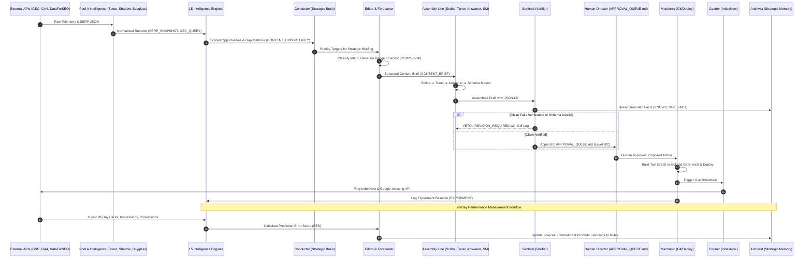

# End-to-End Data Flow & Lifecycle
## Data Ingestion, Synthesis, Drafting, Verification, Release & Calibration

```
========================================================================================
VIYOGI AGENTIC SEO SWARM — DATA FLOW SPECIFICATION
========================================================================================
```

## 1. End-to-End Data Lifecycle Overview

Data moves through the swarm across **8 distinct lifecycle phases**. At every transition boundary, records must conform to the **V3.1 Canonical Data Contract**:

```
[Phase 1: Ingest] ➔ [Phase 2: Synthesize] ➔ [Phase 3: Strategize] ➔ [Phase 4: Assemble]
         │                     │                     │                     │
         ▼                     ▼                     ▼                     ▼
[Phase 8: Learn]  ◄─ [Phase 7: Measure]  ◄─ [Phase 6: Release]   ◄─ [Phase 5: Verify]
```

---

## 2. Data Source Authority & Provenance Model

To prevent hallucinations, conflicting metric interpretations, and data contamination, data flow adheres to a strict **Source Authority Hierarchy** and **Universal Provenance Envelope**:

### 2.1 Authority Hierarchy
1. **First-Party Ground Truth (Highest Authority):**
   - **Google Search Console API:** Authoritative on actual Google impressions, clicks, query rankings, and index coverage.
   - **Google Analytics 4 Data API:** Authoritative on sessions, engagement duration, form completions, and commercial inquiries/RFQs.
   - **Knowledge Bank & D1 / RTDB Stores:** Authoritative on verified brand facts, technical specs, tolerances, and pricing.
2. **External Competitive Truth:**
   - **DataForSEO API Suite:** Authoritative on live SERP layouts, competitor rankings, Google PAA questions, and search volumes.
   - **Firecrawl API / Clean Parsers:** Authoritative on competitor heading hierarchy, page depth, and on-page structured data.
3. **Validation & Supplementary Layer:**
   - **Google Ads Keyword Planner:** Commercial CPC and advertiser competition validation.
   - **Bing Webmaster Tools & IndexNow:** Bing SERP metrics and instant crawler dispatch.

### 2.2 Universal Data Provenance Schema
Every measurement and finding emitted through the swarm carries an immutable provenance envelope (`universal_record_metadata.json`):
- `provenance_id`: Unique UUID v4 for the observation event.
- `source`: Explicit source identifier (`GSC_SEARCH_ANALYTICS`, `GA4_DATA_API`, `DATAFORSEO_LIVE_SERP`, etc.).
- `evidence_level`: One of `OBSERVED`, `MEASURED`, `INFERRED`, `HYPOTHESIS`.
- `retrieved_at`: ISO 8601 timestamp.
- `confidence`: `HIGH`, `MEDIUM`, or `LOW`. Records lacking provenance are automatically discarded by Conductor.

---

## 3. Phase-by-Phase Execution Flow



---

## 3. Data Flow Stages & Canonical Artifacts

### Stage 1: Telemetry Ingestion
- **Inputs:** Google Search Console (`searchAnalytics.query`), Google Analytics 4 (`runReport`), DataForSEO Live Advanced SERP, Bing Webmaster Tools API, Firecrawl Markdown scrapes.
- **Processing:** Raw HTTP responses are parsed immediately. Raw HTML is discarded; only structured data is retained.
- **Canonical Schemas Emitted:**
  - `GSC_QUERY` (Query, Page, Clicks, Impressions, CTR, Position)
  - `GA4_LANDING_PAGE` (Sessions, Engaged Sessions, Conversions, Key Events)
  - `SERP_SNAPSHOT` (Rankings, URLs, Features, PAA Questions)
  - `COMPETITOR` & `COMPETITOR_PAGE` (Heading hierarchy, word count, schemas)

### Stage 2: Synthesis & Opportunity Detection
- **Processing:** The 15 stateless Intelligence Engines process Stage 1 records:
  - **Decay Engine:** Filters queries/pages showing >20% loss over 28/60/90 days.
  - **Striking-Distance Filter:** Identifies queries in positions 4.0 through 20.0 with high commercial intent.
  - **PAA Engine:** Clusters questions into informational vs procurement intents.
  - **Opportunity Engine:** Computes composite Opportunity Scores:
    $$\text{Score} = \frac{\text{Commercial Intent} \times \text{Search Volume} \times \text{Business Value}}{\text{Estimated Effort}}$$
- **Canonical Schemas Emitted:**
  - `CONTENT_GAP`
  - `CONTENT_OPPORTUNITY`
  - `PAA_QUESTION`

### Stage 3: Strategic Planning & Decision
- **Processing:** Conductor queries Strategic Memory (Archivist) and resolves the **Next Best Action**. Editor determines whether to create a new page, update an existing page, consolidate, or do nothing. Forecaster models the range of probable outcomes:
  - **P10 (Pessimistic):** Minimal movement; competitive defenses hold.
  - **P50 (Realistic):** Expected progression into page-one striking distance.
  - **P90 (Optimistic):** Rapid featured snippet or top-3 ranking.
- **Canonical Schemas Emitted:**
  - `NEXT_BEST_ACTION`
  - `CONTENT_BRIEF`
  - `FORECAST`

### Stage 4: Sequential Content Assembly
- **Processing:** Pool B executes sequentially:
  1. **Scribe:** Drafts rich, technically grounded Markdown using verified facts from Archivist and following the project's Human Writing Guide (zero banned buzzwords).
  2. **Tuner:** Polishes Title (<55 chars), Meta Description (<155 chars), and semantic H1/H2 hierarchy.
  3. **Answerer:** Injects 40–60 word concise direct-answer blocks and FAQ accordions.
  4. **Schema Master:** Formats JSON-LD structured data blocks aligned with on-page copy.
- **Canonical Schemas Emitted:**
  - `CONTENT_VERSION`
  - `CONTENT_CHANGE`
  - `STRUCTURED_DATA`

### Stage 5: Verification Gateway
- **Processing:** Sentinel performs claim-by-claim verification against Archivist's `KNOWLEDGE_FACT` records. It validates JSON-LD schemas against Google Rich Results standards.
- **Verdicts:**
  - `REJECTED`: Factual hallucination detected. Immediate rollback/revision prompt to Scribe.
  - `VERIFIED`: Passed all checks. Emitted to human review.
- **Canonical Schema Emitted:**
  - `CONTENT_APPROVAL`

### Stage 6: Human Approval & Execution
- **Processing:** Human Growth Director inspects `APPROVAL_QUEUE.md`. Upon approval:
  1. **Mechanic** checks out an isolated Git branch (`git checkout -b seo/update-feature`).
  2. Runs build verification (`npm run build`).
  3. Deploys to edge hosting (Cloudflare Pages / Workers).
  4. **Courier** immediately pings IndexNow and Google Indexing API.
- **Canonical Schemas Emitted:**
  - `EXPERIMENT`
  - `TRACKING_EVENT`

### Stage 7: Measurement & Attribution
- **Processing:** Telemetry streams track the deployed URL across a 28-day window. Impressions, rankings, clicks, and conversion inquiries are attributed to the specific `EXPERIMENT_ID`.
- **Canonical Schemas Emitted:**
  - `KPI_BASELINE`
  - `AI_VISIBILITY`

### Stage 8: Retrospective Learning & Calibration
- **Processing:** Forecaster compares actual 28-day results against the original P10/P50/P90 forecast to calculate the Prediction Error Score (PES):
  $$\text{PES} = \left| \frac{\text{Actual Position} - \text{P50 Target}}{\text{Baseline Position} - \text{P50 Target}} \right|$$
- Archivist updates Strategic Memory:
  - Confirmed outcomes become **Learnings**.
  - Repeatedly validated learnings become **Strategic Rules**.
- **Canonical Schemas Emitted:**
  - `STRATEGIC_RULE`
  - `LEARNING`
  - `STRATEGY_STATE`
