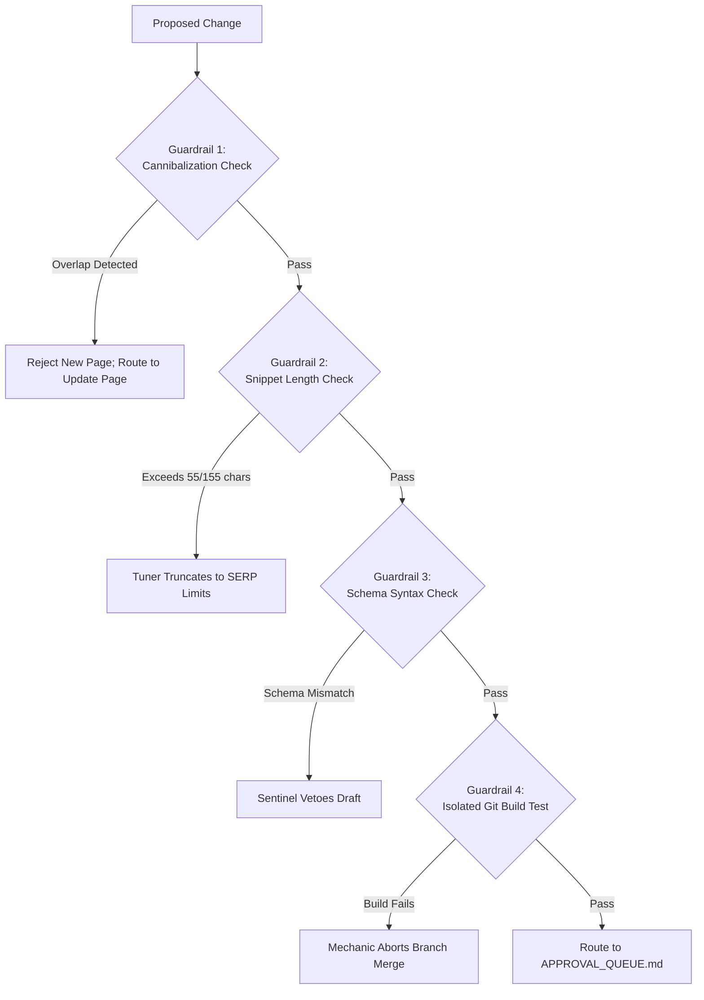

# Regression Testing & Guardrails
## Safeguarding Existing Rankings, Schemas, and Site Performance

```
========================================================================================
VIYOGI AGENTIC SEO SWARM — REGRESSION TESTING SPECIFICATION
========================================================================================
```

## 1. Regression Risk Vectors in Autonomous SEO

Autonomous SEO agents risk creating negative side effects if unconstrained:
1. **Keyword Cannibalization Regression:** Publishing a new page that splits rankings and clicks with an existing high-ranking URL.
2. **Title/Meta Truncation Regression:** Expanding a title tag beyond 55 characters, causing SERP ellipsis (`...`).
3. **Structured Data Syntax Regression:** Modifying page copy without updating JSON-LD, causing schema mismatch penalties.
4. **Internal Link Degradation:** Deleting or altering contextual internal link anchors during content rewrites.
5. **Core Web Vitals Regression:** Injecting uncompressed media or unoptimized client-side JavaScript.

---

## 2. Automated Regression Guardrails



---

## 3. Reversibility Protocol

Every production change is required to be **100% reversible**:
- Mechanic stores the pre-change content snapshot in `data/versions/` with an immutable `VERSION_ID`.
- If an unexpected ranking or traffic drop occurs within 14 days of release, Mechanic can execute a 1-click rollback:
  ```bash
  python3 scripts/rollback_change.py --action-id ACT-012
  ```
  This restores the previous Git commit and triggers Courier to immediately broadcast the restored URL.
