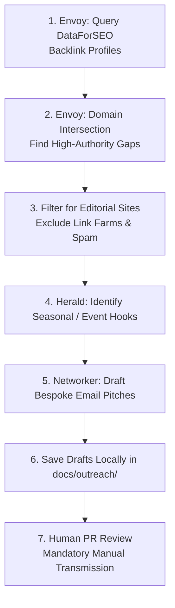

# Workflow: Backlink Intelligence & Digital PR
## Authority Gap Quantification, Media Discovery & Bespoke Editorial Pitch Drafting

```
========================================================================================
WORKFLOW SPECIFICATION — BACKLINK INTELLIGENCE & DIGITAL PR
========================================================================================
```

### 1. Objective
Identify high-authority, topically relevant referring domain opportunities from industry publications, trade associations, and niche media, and draft tailored, value-first editorial pitch emails that earn organic backlinks without automated spam.

### 2. Trigger
Triggered monthly by Conductor, or immediately following the publication of an original research whitepaper or major brand announcement.

### 3. Required Data
- Competitor domain lists from `knowledge-bank/competitors.json`.
- Published original research asset or whitepaper URL.
- Trade media and association directory registry.

### 4. Agents Involved
- **Envoy (#7):** Quantifies backlink profiles and authority gaps.
- **Networker (#18):** Drafts tailored, human-sounding editorial pitch emails.
- **Herald (#19):** Identifies trade shows, events, and seasonal press angles.
- **Human PR Manager:** Reviews and transmits all outbound communication.

### 5. Tools and Integrations
- `DataForSEO Backlinks API`: Domain intersection and referring domain quality analysis.
- `Bing Webmaster Tools`: Link telemetry.
- Email Drafting Engine: Formats Markdown pitch drafts locally.

### 6. Step-by-Step Execution


1. **Step 1 (Backlink Ingestion):** Envoy queries DataForSEO Backlinks API to audit referring domain counts and authority metrics for our site and top 3 competitors.
2. **Step 2 (Domain Intersection):** Envoy identifies authoritative domains (DA 40+) that link to multiple competitors but do not link to our domain.
3. **Step 3 (Quality Filtering):** Envoy filters out low-quality PBNs, automated scraping directories, and paid link schemes.
4. **Step 4 (Hook Formulation):** Herald matches the publication's focus to upcoming seasonal trends or trade events (e.g. ANKIROS foundry exhibition or winter mountain travel).
5. **Step 5 (Pitch Drafting):** Networker drafts a tailored, human-sounding pitch referencing the editor's specific beat, proposing original data, high-resolution media, or an expert interview.
6. **Step 6 (Local Storage):** Networker saves the pitch draft to `docs/outreach/` with zero automated sending.
7. **Step 7 (Human Execution):** The human PR manager reviews, customizes, and manually transmits the email from their corporate inbox.

### 7. Intermediate Outputs
- `AuthorityGapReport` JSON.
- Qualified media target profiles.

### 8. Final Output
- Tailored Markdown pitch drafts stored in `docs/outreach/` for manual human transmission.

### 9. Approval Gates
- **Strict Level C Gate (Zero Auto-Send):** Agents are strictly prohibited from possessing SMTP credentials or transmitting emails autonomously.

### 10. Error Handling
- **Missing Editorial Contact:** Networker formats the pitch with a note requesting human verification of the editor's current email address.

### 11. Cost Considerations
- Envoy uses Fast models for parsing backlink tables; Networker uses Mid-tier models for natural human-grade phrasing.

### 12. Evaluation Criteria
- Zero spam complaints.
- High editorial pickup rate on pitches manually transmitted by the human PR lead.

### 13. Implementation Status
**Implemented & Tested** across both Suntec Enterprises and VivaakVaza.

### 14. Known Limitations
- Backlink indexes update with third-party crawler delays (typically 2–4 weeks behind live publication).
