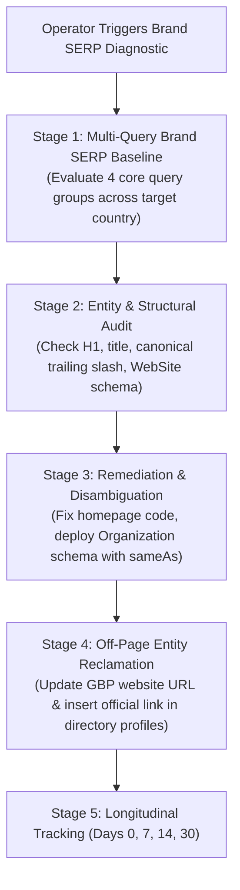

# Reusable Brand SERP Recovery & Search Structure Workflow
## Diagnostic Runbook for Resolving Entity Splitting, Competing Domains & Canonical Drift

```
========================================================================================
VIYOGI AGENTIC SEO SWARM — BRAND SERP RECOVERY WORKFLOW
========================================================================================
```

## 1. Problem Statement & Background

A recurring challenge for established B2B and regional businesses transitioning to modern official web properties is **Brand SERP Underperformance**:
- The official domain (`.com`) ranks outside the top 50 for the exact brand name.
- Third-party B2B directory portals (e.g. IndiaMART, TradeIndia, JustDial) or legacy subdomains occupy the top 3 positions.
- Search engines suffer from **Brand Entity Fragmentation**, splitting search equity between outdated directory profiles and the new website.

This workflow provides a repeatable, 4-stage diagnostic and remediation procedure verified in the Suntec Enterprises audit.

---

## 2. Participating Agents
- **Conductor (#1):** Master recovery coordinator.
- **Scout (#4):** Live SERP diagnostic across exact brand queries.
- **Mechanic (#16):** H1, title, and trailing slash canonical remediation.
- **Schema Master (#15):** Organization & WebSite JSON-LD entity disambiguation.
- **Sentinel (#3):** Quality and verification gate.

---

## 3. Four-Stage Remediation Protocol



### Stage 1: Multi-Query Brand SERP Baseline
Run DataForSEO Live Advanced SERP across 4 brand query categories:
1. **Core Brand:** `"[Brand Name]"` and `"[Brand Name] [Country]"`
2. **Product + Brand:** `"[Core Product] [Brand Name]"`
3. **Location + Brand:** `"[Brand Name] [City]"`
4. **Website Intent:** `"[Brand Name] official website"`
*Record baseline positions and top competitors in `BRAND_SERP_BASELINE_AUDIT.json`.*

### Stage 2: Codebase Structural & Entity Audit
Inspect homepage code for 4 common points of failure:
- **Missing Brand in H1:** Is the primary `<h1>` tag generic (e.g. *"Precision Peening Media"*) rather than naming the brand (*"[Brand Name] | Precision Peening Media"* )?
- **Weak Title Tag:** Does the title tag start with the brand name or place it after 60 characters?
- **Trailing Slash Canonical Mismatch:** Does `<link rel="canonical">` match the exact sitemap and HTTP header URL format (e.g. `https://domain.com/` vs `https://domain.com`)?
- **Schema Multi-Entity Confusion:** Does the page output conflicting schema IDs or lack a dedicated `WebSite` schema declaring official search box and publisher entities?

### Stage 3: On-Page Remediation & Code Modification
1. **Homepage H1 Update:** Ensure the exact legal brand name appears in the opening `<h1>`.
2. **Title Optimization:** Format title as: `"[Brand Name] | [Primary Category Manufacturer/Provider] | [Official Website]"`.
3. **Structured Data Entity Grounding:** Inject comprehensive JSON-LD:
   - `Organization` schema with `name`, `legalName`, `url`, `logo`, and `sameAs` array linking to directory profiles and social accounts.
   - `WebSite` schema with canonical URL and search potential action.
4. **Build Verification:** Run `npm run build` to ensure clean SSG compilation.

### Stage 4: Off-Page Entity Reclamation
- **Google Business Profile:** Ensure the primary website button links directly to the official canonical URL (`https://domain.com/`).
- **Directory Profile Backlinks:** Update B2B directory profiles (IndiaMART, TradeIndia, YellowPages) with an explicit attribution link:
  > *"Official Corporate Website & Global Technical Hub: [https://domain.com](https://domain.com)"*

---

## 4. Evaluation Milestones (Days 0, 7, 14, 30)

| Milestone | Target Metric | Verification Method |
| :--- | :--- | :--- |
| **Day 0** | Baseline recorded; codebase fixes applied and verified. | `BRAND_SERP_BASELINE_AUDIT.json` logged |
| **Day 7** | Search engines re-crawl homepage; verify updated H1 and schema. | DataForSEO live HTML cache check |
| **Day 14** | Official domain enters Top 10 for core brand queries. | Automated DataForSEO SERP scan |
| **Day 30** | Official domain claims **Position #1** for exact brand search. | Complete 4-category brand SERP re-evaluation |
