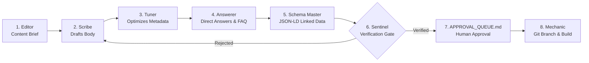

# Workflow: Sequential Content Assembly Pipeline
## Pool B End-to-End Drafting, Tuning, AEO Structuring, Schema Modeling & Verification

```
========================================================================================
WORKFLOW SPECIFICATION — SEQUENTIAL CONTENT ASSEMBLY PIPELINE
========================================================================================
```

### 1. Objective
Produce publication-ready, deeply authoritative articles, technical guides, or landing pages that win page-one organic rankings, capture Google Featured Snippets, trigger citations in Google AI Overviews, and drive qualified commercial inquiries — with zero factual hallucinations.

### 2. Trigger
Triggered when Conductor prioritizes an action and Editor produces an approved `CONTENT_BRIEF` record.

### 3. Required Data
- Approved `CONTENT_BRIEF` (`schemas/v3_1/content_brief.json`).
- Verified technical facts or property amenities from Archivist (`KNOWLEDGE_FACT`).
- Project `human-writing-guide.md` (banned buzzword list and style rules).
- Clustered PAA questions from the PAA Question Bank.

### 4. Agents Involved
- **Editor (#20):** Produces structural brief and constraints.
- **Scribe (#12):** Drafts authoritative body text.
- **Tuner (#13):** Optimizes titles, meta descriptions, and heading tags.
- **Answerer (#14):** Extracts 40–60 word direct-answer callouts and FAQ accordions.
- **Schema Master (#15):** Formats synchronized JSON-LD structured data.
- **Sentinel (#3):** Zero-tolerance verification gatekeeper.
- **Mechanic (#16):** Implements approved changes in code.

### 5. Tools and APIs Used
- `ArchivistFactStore` (SQL / Firebase RTDB lookups).
- Python length and diff validators.
- Schema.org Draft 2020-12 validator (`validator.py`).

### 6. Step-by-Step Execution


1. **Step 1 (Briefing):** Editor provides structural brief specifying H1, H2s, H3s, primary/secondary keywords, required entity specs, and banned buzzwords.
2. **Step 2 (Drafting):** Scribe queries Archivist for verified specs and drafts the complete Markdown body. Scribe includes detailed specification tables and factual evidence.
3. **Step 3 (On-Page Tuning):** Tuner writes an optimized Title Tag (<55 chars) and Meta Description (<155 chars with a CTR hook), verifies the heading hierarchy (single H1), and embeds internal links from Gardener.
4. **Step 4 (AEO Structuring):** Answerer inserts concise 40–60 word direct-answer blocks beneath core question headers and appends an FAQ accordion answering remaining PAA queries.
5. **Step 5 (Schema Modeling):** Schema Master generates rich JSON-LD script blocks (`Product` or `LodgingBusiness`, `FAQPage`, `BreadcrumbList`) strictly synchronized with visible text.
6. **Step 6 (Verification Audit):** Sentinel extracts all discrete factual claims and validates them against Archivist. It checks for banned buzzwords and validates JSON-LD syntax.
   - If invalid: Sentinel halts the pipeline and sends an exact diff back to Scribe for remediation.
   - If verified: Sentinel emits `VERIFIED` verdict.
7. **Step 7 (Human Governance):** The verified package is queued in `APPROVAL_QUEUE.md`.
8. **Step 8 (Execution):** Upon human approval, Mechanic implements changes in an isolated Git branch, tests the build (`npm run build`), and prepares the edge release.

### 7. Intermediate Outputs
- `ScribeDraft` (Raw Markdown text).
- `TunedDraft` (Markdown with metadata headers).
- `AEODraft` (Markdown with direct answers and FAQ accordion).
- `CandidatePackage` (Markdown + JSON-LD script blocks).

### 8. Final Output
- Approved, verified production asset queued in `APPROVAL_QUEUE.md` and committed to an isolated Git branch by Mechanic.

### 9. Approval Gates
- **Sentinel Automated Gate:** Absolute veto on hallucinations or schema defects.
- **Human Approval Gate (Level B):** Mandatory review in `APPROVAL_QUEUE.md` before merging to production.

### 10. Error Handling
- **Factual Discrepancy:** Sentinel rejects draft, identifies the offending line, and forces Scribe to align with verified `KNOWLEDGE_FACT` records.
- **Length Violation:** Tuner automatically re-shortens title/meta tags if character limits exceed SERP thresholds.

### 11. Cost Considerations
- **Token Tiering:** Scribe and Sentinel utilize Heavyweight/Pro models (Claude 3.7 / Gemini 3.1 Pro); Tuner, Answerer, and Schema Master utilize Fast/Flash models.
- Total token expenditure: ~6,000 to 10,000 tokens per published long-form guide.

### 12. Evaluation Criteria
- 100% pass rate on Sentinel factual audit.
- 0 Rich Results errors on Google Rich Results tests.
- Title and meta tags display without truncation on live SERP.

### 13. Implementation Status
**Implemented & Tested** across both Suntec Enterprises and VivaakVaza.

### 14. Known Limitations
- High-reasoning model drafting requires 60–90 seconds per pipeline run; not intended for real-time interactive generation.
