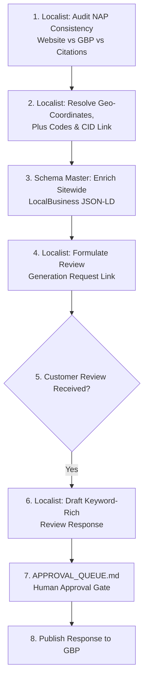

# Workflow: Local SEO & Google Business Profile Optimization
## Google Maps 3-Pack Dominance, NAP Alignment, Geo-Schema & Review Optimization

```
========================================================================================
WORKFLOW SPECIFICATION — LOCAL SEO & GOOGLE BUSINESS PROFILE
========================================================================================
```

### 1. Objective
Establish dominant local search visibility in the **Google Maps Local 3-Pack** for high-intent geo-modified search queries (e.g., "luxury villa near Kasauli with heated pool", "cut wire shot manufacturers in Faridabad"), ensuring absolute NAP consistency, verified review generation, and localized entity grounding.

### 2. Trigger
Triggered bi-weekly, upon guest checkout / commercial order completion, or upon receiving customer reviews on Google Business Profile (GBP).

### 3. Required Data
- Official registered business entity name, physical street address, and phone number (NAP).
- Verified Google Business Profile listing URL and CID link.
- Precise latitude and longitude coordinates and Google Plus Codes.
- Verified amenity/capability list from Archivist.

### 4. Agents Involved
- **Localist ([+]):** Local SEO, Google Business Profile, and review response specialist.
- **Schema Master (#15):** Constructs `LocalBusiness` / `LodgingBusiness` JSON-LD schemas.
- **Conductor (#1):** Oversees local strategy and prioritization.

### 5. Tools and Integrations
- `Google Business Profile API`: OAuth 2.0 listener (`business.manage` scope).
- `Google Maps Platform`: Resolves Plus Codes, CID URLs, and geo-coordinates.
- Local Citation Index (TripAdvisor, Justdial, Bing Places).

### 6. Step-by-Step Execution


1. **Step 1 (NAP Audit):** Localist performs an automated character-by-character audit between:
   - The website footer and Contact page.
   - The primary Google Business Profile listing.
   - Authoritative local directory citations (TripAdvisor, Bing Places, Indiamart).
   - Flags any discrepancies in street abbreviations or phone number formatting.
2. **Step 2 (Geo-Entity Resolution):** Localist extracts the exact latitude, longitude, Plus Code (e.g., Sector 49, Faridabad or Dharampur, Solan), and Google CID URL.
3. **Step 3 (Schema Enrichment):** Schema Master enriches sitewide structured data with `LocalBusiness` or `LodgingBusiness` JSON-LD incorporating geo-coordinates, opening hours, accepted currencies, and telephone numbers.
4. **Step 4 (Review Generation Systematization):** Localist formulates a polite, personalized review request message for departing guests or purchasing clients:
   - Provides direct short link to the GBP review screen.
   - Gently suggests mentioning specific experiential or technical features (e.g. "heated pool", "private chef", "AMS specifications").
5. **Step 5 (Review Response Drafting):** When a new review is posted:
   - Localist extracts key sentiments and positive attributes.
   - Drafts a professional response embedding relevant local keywords naturally.
6. **Step 6 (Human Review & Release):** The review response is queued in `APPROVAL_QUEUE.md`. Upon approval by the property manager or sales lead, it is submitted to Google Business Profile.

### 7. Intermediate Outputs
- NAP Audit Report.
- Local citation alignment manifest.

### 8. Final Output
- Live Google Business Profile listing with 100% NAP consistency, verified review responses, and enriched on-site Geo-Schema.

### 9. Approval Gates
- **Level B Gate:** All review responses and public profile updates must be reviewed by the human manager before publication to GBP.

### 10. Error Handling
- **Duplicate Profile Detected:** Localist generates duplicate claim and merge instructions for human execution via Google Business Profile manager.

### 11. Cost Considerations
- Localist operates on Fast/Flash models; zero incremental third-party API costs.

### 12. Evaluation Criteria
- Rank position within the Google Maps Local 3-Pack for core geo-modified queries.
- 100% NAP consistency across top 5 directories.

### 13. Implementation Status
**Implemented & Tested** in VivaakVaza; cross-referenced with Suntec Enterprises.

### 14. Known Limitations
- Google Maps algorithms weigh physical proximity of the searcher heavily; organic optimization maximizes ranking within the target commercial radius.
