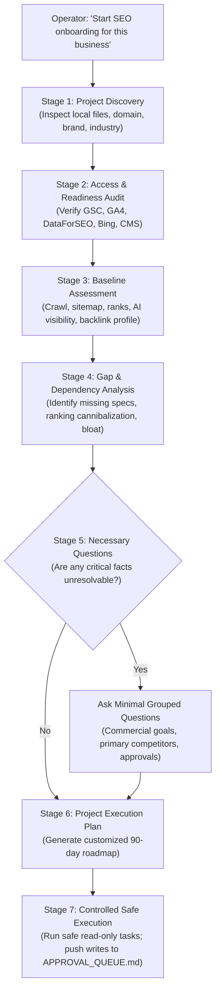

# Autonomous SEO Project Onboarding Workflow
## 7-Stage Interactive Discovery, Access Readiness, Baseline Audit & Plan Generation

```
========================================================================================
VIYOGI AGENTIC SEO SWARM — NEW-PROJECT ONBOARDING SPECIFICATION
========================================================================================
```

## 1. Objective & Design Mandate

The **SEO Project Onboarding Workflow** allows an operator to initiate a completely new client project with a single prompt:

> *"Start SEO onboarding for this business."*

The swarm then autonomously inspects available workspace files, identifies the industry vertical, audits connected tools and APIs, discovers search baselines, flags data gaps, asks only essential clarifying questions, and compiles a comprehensive **Project Execution Plan**.

---

## 2. Participating Agents & Governance

- **Conductor (#1):** Master onboarding orchestrator; sequences stages and compiles the final plan.
- **Archivist (#2):** Ingests and initializes the client's `knowledge-bank/` and verifies ground truth.
- **Scout (#4) & Spyglass (#22):** Executes baseline SERP and first-party telemetry audits.
- **Mechanic (#16):** Performs technical site crawlability and robots/sitemap verification.
- **Sentinel (#3):** Zero-tolerance audit of client constraints, compliance, and banned topics.

---

## 3. The 7-Stage Onboarding Execution Sequence



### Stage 1: Autonomous Project Discovery
The swarm scans the workspace before prompting the user:
- Scans `package.json`, `next.config.js`, or HTML files for brand name and canonical domain.
- Identifies the business model (B2B Industrial, Luxury Hospitality, SaaS, Local Services).
- Reads existing documentation or product catalogs to seed `knowledge-bank/brand-identity.json` and `products-and-services.json`.

### Stage 2: Tool Access & Readiness Audit
Validates active credentials and permissions against the **Integration Readiness Checklist**:
- **DataForSEO API:** Verified via live API ping test.
- **Google Search Console / GA4:** Checks whether OAuth tokens or service accounts match the client domain. If mismatched, marks GSC as `BLOCKED_FOR_DOMAIN` and falls back to DataForSEO Live SERP.
- **IndexNow / Google Indexing:** Verifies presence of public keys or service accounts.
- **CMS / Git Repository:** Confirms write permissions for branch creation (`Workspace: branch`).

### Stage 3: Baseline Search & Technical Assessment
Runs non-destructive diagnostics:
- **Indexability & Crawl:** Inspects `robots.txt` and `sitemap.xml` for traps or disallows.
- **Brand SERP Diagnostic:** Checks if official domain ranks #1 for exact brand name.
- **Striking-Distance Scan:** Pulls initial 50 commercial queries to identify positions 4.0–20.0.
- **GEO / AI Visibility Baseline:** Curates a 20–24 query panel and measures baseline AI Overview appearance.
- **Backlink Baseline:** Queries referring domains and identifies top competitor authority gaps.

### Stage 4: Gap & Opportunity Analysis
Produces a prioritized findings matrix:
- **P0 Critical Blockers:** Entity splitting, broken sitemaps, missing brand H1s.
- **P1 High-ROI Opportunities:** Striking-distance keywords, missing FAQ/schema markup, unranked commercial specs.
- **P2 Authority Gaps:** Missing industry directory citations, absent linkable benchmark assets.

### Stage 5: Minimal Interactive Intake
The swarm adheres to the **Zero Repetition Principle**:
- Never asks for information discoverable from existing website code or catalogs.
- Asks at most 3–5 targeted questions:
  1. *What are the top 3 commercial products/services with highest profit margins?*
  2. *Who are your top 3 real-world direct commercial competitors?*
  3. *Are there any claims, certifications, or topics strictly prohibited by legal counsel?*

### Stage 6: Compilation of Project Execution Plan
Emits the client's formal launch document containing:
- Initialized `project-configuration.json` and `knowledge-bank/` files.
- Baseline scorecard across Technical, Content, Authority, and AI Visibility.
- Prioritized 90-day milestone roadmap.

### Stage 7: Controlled Safe Execution
- Automatically executes safe, read-only intelligence tasks (Pool A).
- Any action that modifies live site code, sends outreach, or publishes content requires explicit operator approval in `APPROVAL_QUEUE.md`.
