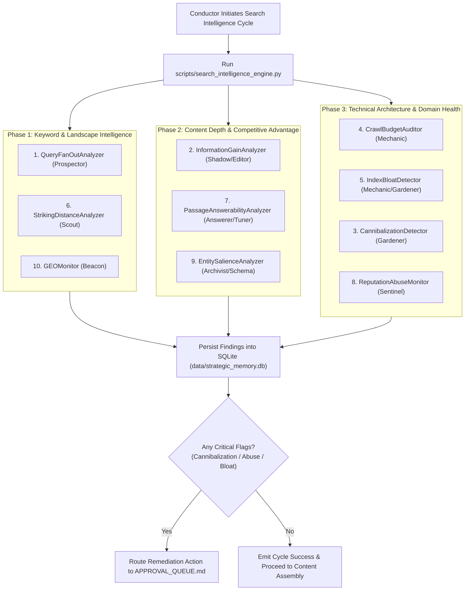

# Search Intelligence & Technical Autonomy Pipeline Workflow
## 10-Capability Automated Diagnostic, Scoring & Strategic Remediation Runbook

```
========================================================================================
VIYOGI AGENTIC SEO SWARM — SEARCH INTELLIGENCE & TECHNICAL AUTONOMY WORKFLOW
========================================================================================
```

## 1. Objective
To execute comprehensive, automated search intelligence diagnostics across 10 critical search dimensions without requiring manual SEO audit tools. The workflow identifies query fan-outs, quantifies information gain against top competitors, detects cannibalization conflicts, audits crawl budget and index bloat, flags striking-distance opportunities, verifies passage answerability, monitors site reputation integrity, models entity graphs, and tracks Generative Engine Optimization (GEO) AI visibility.

---

## 2. Trigger
- **Weekly Automated Scan:** Triggered by Conductor during Phase 1 scheduled intelligence runs.
- **On-Demand Diagnostic:** Run prior to significant site restructuring, major content publishing sprints, or post-Google Core Update releases.
- **CLI Invocations:** Executed via `python3 scripts/search_intelligence_engine.py` or unit tests `python3 scripts/test_search_intelligence.py`.

---

## 3. Required Data
- **Seed Query & Market:** Target commercial query (e.g. `"cut wire shot"`) and target country code (`"IN"`, `"US"`, `"DE"`).
- **Target URL & Content:** Published page Markdown or HTML.
- **Sitemap & Route Manifest:** Dynamic routes from `sitemap.js` or static Next.js routing tree.
- **DataForSEO Telemetry:** Live SERP JSON, PAA questions, and AI Overview extractions.
- **Strategic Memory Store:** Verified Level 1 corporate facts in `strategic_memory.db`.

---

## 4. Agents Involved
- **Conductor (#1):** Pipeline orchestration, coordination of sub-modules, and Next Best Action resolution.
- **Prospector (#5):** Multi-tier directed Query Fan-Out graph construction.
- **Shadow (#6) & Editor (#20):** Competitor topic extraction and Information Gain scoring (0–100).
- **Gardener (#8):** Pairwise keyword cannibalization detection and link equity preservation.
- **Mechanic (#16):** Crawl budget depth auditing and index bloat / thin content detection.
- **Scout (#4):** Striking-distance query filtering (pos 4–20) and Opportunity Index computation.
- **Answerer (#14) & Tuner (#13):** Semantic passage chunking, direct answer evaluation, and AEO gap detection.
- **Sentinel (#3):** Site reputation abuse scanning (parasitic subdirectories, outbound link drift, spam backlinks).
- **Archivist (#2) & Schema Master (#15):** Entity salience scoring and RDF Knowledge Graph triple generation.
- **Beacon (#9):** AI Overview presence tracking and Share of AI Voice (SOV) calculation.

---

## 5. Tools and APIs Used
- `scripts/search_intelligence_engine.py`: Unified modular execution engine.
- DataForSEO Live Advanced Google SERP API (`serp/google/organic/live/advanced`).
- SQLite Database: `data/strategic_memory.db` (10 dedicated search intelligence tables).
- Static File Parsers: `robots.js`, `sitemap.js`, and Next.js page components.

---

## 6. Step-by-Step Execution Sequence



1. **Step 1: Fan-Out & Striking-Distance Expansion:**
   - Prospector calls `QueryFanOutAnalyzer` to generate a 5-tier directed taxonomy tree.
   - Scout calls `StrikingDistanceAnalyzer` to compute the Opportunity Index for positions 4.0–20.0.
2. **Step 2: Competitive Information Gain & GEO Audit:**
   - Shadow scrapes top 5 ranking competitor URLs.
   - InformationGainAnalyzer scores technical novelty, comparison matrices, and formula completeness.
   - Beacon checks if Google serves an AI Overview and measures brand citation share.
3. **Step 3: Technical Integrity, Cannibalization & Bloat:**
   - Mechanic verifies crawl depth ($\le 3$) and flags crawl traps.
   - Gardener runs pairwise cosine/semantic similarity across site URLs to detect cannibalization.
   - Mechanic flags thin pages ($< 300$ words) to determine Index Efficiency.
4. **Step 4: Passage Answerability & Entity Graphing:**
   - Answerer chunks page text into 40–80 word blocks, checking for entity-first syntax and zero filler.
   - Archivist extracts named entities, calculates structural salience, and generates RDF triples.
5. **Step 5: Reputation & Security Scan:**
   - Sentinel scans route trees for unvetted directories and audits outbound external link integrity.
6. **Step 6: Strategic Memory Storage & Routing:**
   - All 10 modules insert their structured results into dedicated tables in `data/strategic_memory.db`.
   - Any remediation requirements (`CRITICAL` cannibalization, thin content pruning, redirect consolidation) are automatically formatted and pushed to `APPROVAL_QUEUE.md`.

---

## 7. Intermediate & Final Outputs
- **Intermediate Artifacts:**
  - `search_query_fanout` JSON payload.
  - `search_information_gain` gap matrix.
  - `search_striking_distance_queue` priority ranking.
  - `search_passage_answerability` snippet improvement callouts.
  - `search_entity_salience` RDF triples.
- **Final Delivered Assets:**
  - `SEARCH_INTELLIGENCE_EXECUTION_REPORT.md` (Executive summary of all 10 capabilities).
  - Remediation tickets logged in `APPROVAL_QUEUE.md`.

---

## 8. Governance & Approval Boundaries
- **Autonomous (Level A):** Execution of all 10 diagnostic scans, calculation of scores, SERP fetching, and database insertions.
- **Human Gate (Level B/C):** Modifying `robots.js`, applying `noindex` meta tags, deploying 301 redirects to resolve cannibalization, or restructuring live page URLs.
