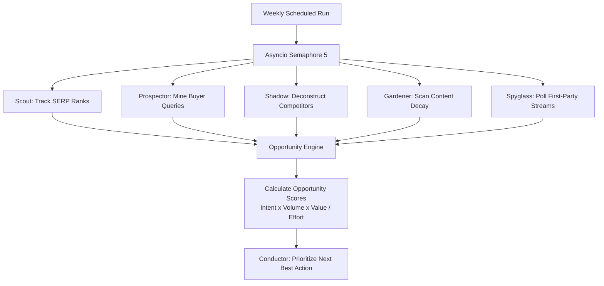

# Workflow: SERP & Opportunity Discovery
## Pool A Parallel Intelligence Gathering, Ranking Audits & Opportunity Scoring

```
========================================================================================
WORKFLOW SPECIFICATION — SERP & OPPORTUNITY DISCOVERY
========================================================================================
```

### 1. Objective
Continuously observe the live search landscape, detect rank changes, uncover emerging buyer queries, deconstruct competitor moves, identify content decay, and score commercial opportunities to feed Conductor's decision engine.

### 2. Trigger
Triggered on a scheduled weekly cron cadence or on-demand when auditing a new business market.

### 3. Required Data
- Priority keyword targets (`KEYWORD` records).
- Connected Google Search Console and GA4 properties.
- Competitor domain lists from `knowledge-bank/competitors.json`.

### 4. Agents Involved
- **Pool A Workers:** Scout (#4), Prospector (#5), Shadow (#6), Envoy (#7), Gardener (#8), Beacon (#9), Spyglass (#11).
- **Subsystem:** Opportunity Engine (Stateless algorithm).
- **Coordinator:** Conductor (#1).

### 5. Tools and Integrations
- `DataForSEO API`: Live Advanced SERP, Keyword Suggestions, Domain Intersection.
- `Google Search Console MCP / API`: Query impressions, clicks, CTR, and positions.
- `Firecrawl API`: Competitor heading and structural scraping.
- `Python Asyncio Semaphore(5)`: Concurrency control.

### 6. Step-by-Step Execution


1. **Step 1 (Parallel Dispatch):** Conductor initiates Pool A execution with concurrency capped at 5 via `asyncio.Semaphore(5)`.
2. **Step 2 (SERP & Rank Tracking):** Scout queries DataForSEO for live ranking positions across target countries; flags queries in positions 4.0 to 20.0 as striking distance.
3. **Step 3 (Query Discovery):** Prospector mines unranked queries from GSC and fetches search volume and CPC data from DataForSEO / Google Ads Keyword Planner.
4. **Step 4 (Competitor Deconstruction):** Shadow scrapes URLs where competitors rank higher and extracts their heading structures (H1–H3) and word count.
5. **Step 5 (Decay & Graph Audit):** Gardener analyzes 28-day vs 90-day GSC performance to detect decaying pages (>20% drop) and orphan pages.
6. **Step 6 (Opportunity Scoring):** The Opportunity Engine processes all findings and scores each opportunity:
   $$\text{Opportunity Score} = \frac{\text{Commercial Intent} \times \text{Search Volume} \times \text{Business Value}}{\text{Estimated Effort}}$$
7. **Step 7 (Prioritization):** Top opportunities are packaged as `CONTENT_OPPORTUNITY` records and handed to Conductor.

### 7. Intermediate Outputs
- `SERP_SNAPSHOT` records.
- `CONTENT_GAP` records.
- `DECAY_ALERT` notifications.

### 8. Final Output
- Prioritized Opportunity Queue presented to Conductor and stored in `data/opportunities/`.

### 9. Approval Gates
- **Level A (Autonomous):** Pool A runs fully autonomously; no human approval required for read, scraping, and scoring.

### 10. Error Handling
- **API Rate Limiting:** Managed by the Semaphore(5) throttle. If an API endpoint returns HTTP 429, the worker backs off for 10 seconds and retries.
- **Competitor Cloudflare Block:** Shadow falls back to parsing search engine snippet descriptions rather than failing.

### 11. Cost Considerations
- Pool A workers utilize Fast/Flash-Lite models (`flash`, `flash-lite`).
- Total token expenditure: <2,500 tokens per weekly run; primary cost is third-party API credits.

### 12. Evaluation Criteria
- Discovers 100% of keywords entering the top-20 striking-distance band within 7 days.
- Successfully attributes competitor heading structures for all tracked competitors.

### 13. Implementation Status
**Implemented & Tested** via `seo/run_phase1_intelligence.py` and DataForSEO connectors.

### 14. Known Limitations
- Search engine personalizations may cause slight variances between API-reported rank and incognito browser results.
