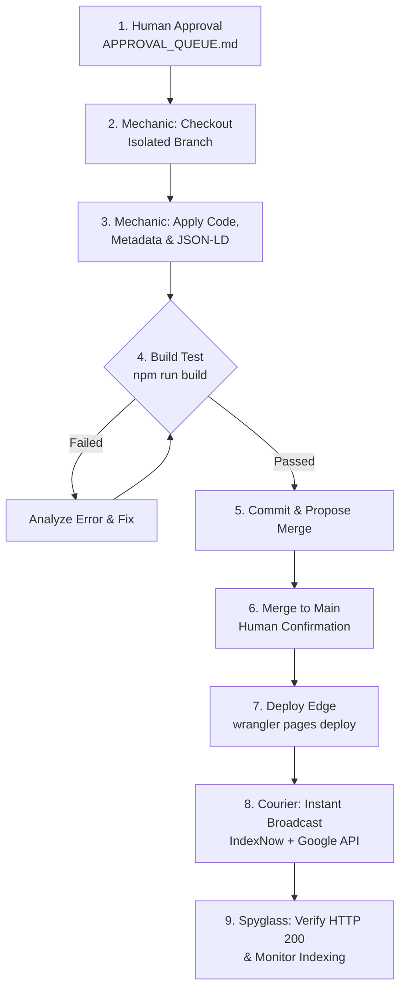

# Workflow: Technical Audit & Fast Indexing
## Codebase Verification, Isolated Branch Deployment & Instant Search Engine Broadcasting

```
========================================================================================
WORKFLOW SPECIFICATION — TECHNICAL AUDIT & FAST INDEXING
========================================================================================
```

### 1. Objective
Safely implement verified content and structured data into the production Next.js codebase, verify build integrity, deploy to Cloudflare Edge infrastructure, and broadcast newly live URLs to Google and Bing within 60 seconds.

### 2. Trigger
Triggered when a proposed action in `APPROVAL_QUEUE.md` is approved by the Human Growth Director.

### 3. Required Data
- Approved `CONTENT_CHANGE` or `CONTENT_VERSION` package.
- Target Git repository path.
- Production Cloudflare deployment configuration (`wrangler.json`).
- IndexNow key and Google service account credentials.

### 4. Agents Involved
- **Mechanic (#16):** Code implementation, build verification, and deployment.
- **Courier ([+]):** Fast indexing broadcaster.
- **Spyglass (#11):** Post-deployment verification listener.

### 5. Tools and Integrations
- `run_command` (Git, npm, Wrangler CLI).
- IndexNow API client (`submit_indexnow.py`).
- Google Indexing API client (`google_indexing.py`).

### 6. Step-by-Step Execution


1. **Step 1 (Authorization Check):** Mechanic inspects `APPROVAL_QUEUE.md` and confirms item status is `APPROVED`.
2. **Step 2 (Workspace Isolation):** Mechanic checks out an isolated Git branch:
   ```bash
   git checkout -b seo/patch-act-012
   ```
3. **Step 3 (Code & Schema Implementation):** Mechanic edits target React components, `generateMetadata` exports, or CMS database records.
4. **Step 4 (Static Build Test):** Mechanic executes the production build test:
   ```bash
   npm run build
   ```
   If errors occur, Mechanic fixes syntax or type issues and re-tests. Broken code is never committed.
5. **Step 5 (Merge Authorization):** Changes are committed to the feature branch and merged into `origin/main` upon confirmation.
6. **Step 6 (Production Deployment):** Mechanic triggers edge deployment:
   ```bash
   ./deploy-cloudflare.sh production
   ```
7. **Step 7 (Instant Broadcast):** Courier broadcasts deployed URLs to IndexNow endpoints and Google Indexing API within 60 seconds.
8. **Step 8 (Telemetry Verification):** Spyglass polls the live URL, confirms HTTP 200 OK, and monitors GSC URL inspection for search engine pickup.

### 7. Intermediate Outputs
- Clean Git commit on isolated feature branch.
- Build test log confirming zero SSG errors.

### 8. Final Output
- Live web page deployed to global Cloudflare Edge network and broadcast to search engine crawlers.

### 9. Approval Gates
- **Level C Gate:** Merging to `main` and deploying to production requires human confirmation.

### 10. Error Handling
- **Build Failure:** Pipeline halts immediately. Changes are reverted; no broken bundles reach staging or production.
- **IndexNow Endpoint Failure:** Courier logs the failed URL and retries automatically via an asynchronous background job.

### 11. Cost Considerations
- Zero third-party API costs; utilizes native Git, npm, Cloudflare Wrangler, and free indexing endpoints.

### 12. Evaluation Criteria
- 100% successful SSG builds on Cloudflare Pages.
- HTTP 200 confirmation from IndexNow endpoints within 60s of release.

### 13. Implementation Status
**Implemented & Tested** across both Suntec Enterprises and VivaakVaza.

### 14. Known Limitations
- Google indexing speed is subject to Googlebot's internal crawling priorities; IndexNow delivers instant notification to Bing and Yandex.
